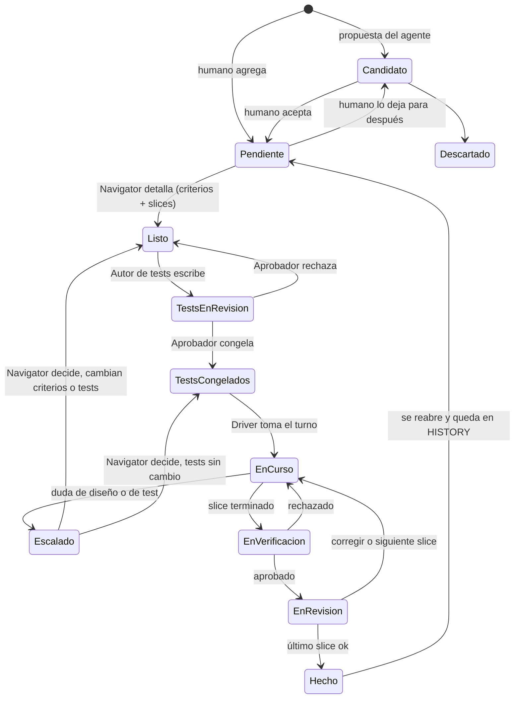
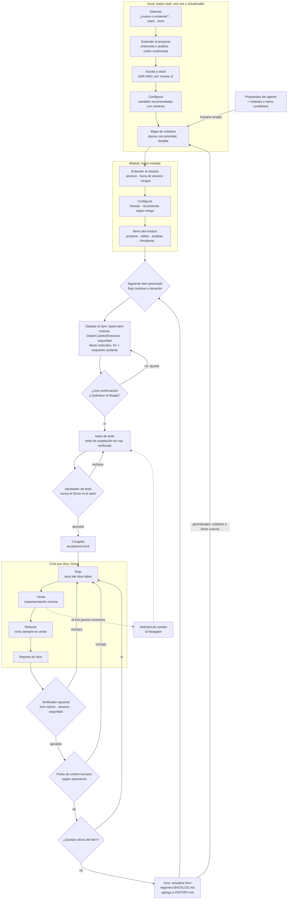
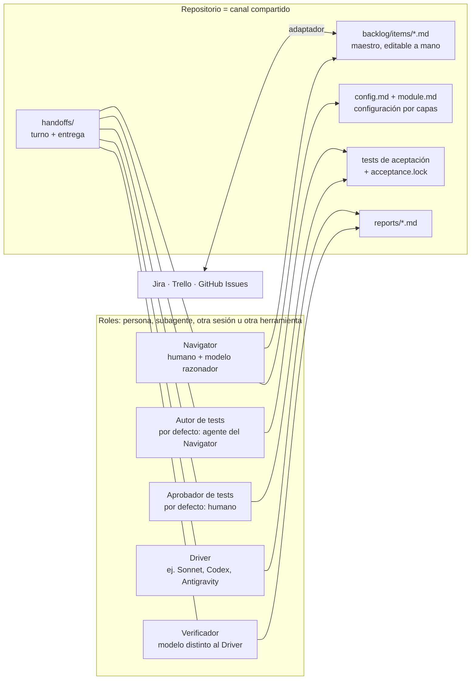

# Baton: metodología de desarrollo iterativo con IA

El nombre viene del testigo (*baton*) de una carrera de relevos: quien lo tiene, tiene el turno, y el traspaso entre roles es pasarlo.

Evolución de SDD (Spec-Driven Development). Su objetivo es que el trabajo con agentes de IA sea **iterable**, que el **control sea atómico** (pieza por pieza) y que cada pieza se **verifique en cuanto se genera**, no todas al final.

Se inspira en las prácticas que mejor funcionaban antes de los agentes: backlog ágil, slices verticales, TDD y pair programming.

> Estado: versión 0.4.1 (2026-11-04). Los formatos de archivo están en [FORMATOS.md](FORMATOS.md) y las skills del núcleo en [skills/](skills/README.md). Pasos siguientes: probar con un proyecto real → `verify`, `review` y adaptadores → app visual.

---

## 1. Principios

1. **Cada dato vive en un solo lugar.** Lo demás se genera a partir de él.
2. **Nada se da por bueno sin una prueba ejecutable.** El criterio de aceptación se escribe como test antes del código.
3. **Quien implementa no decide ni se califica a sí mismo.** Decidir, implementar y verificar son roles separados.
4. **Unidades pequeñas y demostrables.** Cada slice se puede ejecutar y revisar en 15–30 minutos.
5. **El repositorio es el canal.** Todo estado, decisión y traspaso queda en archivos versionados. Ningún rol depende de la memoria de otro, así que cada rol puede estar en un agente, sesión o herramienta distinta.
6. **Todo cambio tiene motivo.** Ningún cambio de alcance, de configuración ni de test congelado ocurre sin quedar registrado.
7. **Modular.** Cada etapa consume y produce archivos definidos. Para saltarse una etapa, basta con dar su archivo a mano.
8. **Entender antes de decidir.** Ninguna recomendación de stack, autonomía o configuración se hace sin haber entendido antes qué se construye, o desde dónde se parte. Las recomendaciones siguen las prácticas de la industria y se justifican con el contexto del proyecto.

---

## 2. Los cuatro pilares

### 2.1 Backlog vivo (desarrollo iterativo)

**Problema en SDD:** pide la spec completa desde el inicio y genera muchos documentos (spec, plan, research, data-model, contracts, quickstart, tasks) que hay que validar juntos. Cambiar algo obliga a corregirlo en todos ellos, y se pierde el control de lo que se diseña.

**Propuesta:** la fuente de verdad del producto es un backlog de ítems pequeños y autocontenidos. El proyecto elige un **tipo principal**, que define la plantilla de los ítems:

| Tipo principal | Forma | Para |
|---|---|---|
| Historia de usuario | "Como… quiero… para…" | producto con usuarios |
| Requerimiento | "El sistema debe…" | sistemas regulados, contratos, integraciones |
| Ticket | problema o tarea | mantenimiento, soporte |

Además, siempre están disponibles los tipos **auxiliares** `bug` y `técnico`, como en los tipos de issue de cualquier equipo. Todos usan criterios *Dado / Cuando / Entonces*, porque los tests salen de ellos.

Cada ítem tiene:

- id;
- valor que aporta;
- criterios de aceptación en formato *Dado / Cuando / Entonces*;
- prioridad;
- estado;
- historial.

Cambiar algo es editar un ítem, no N documentos.

El detalle se trabaja **justo a tiempo**, en tres niveles:

1. **Al inicio:** solo hay una **visión** del sistema y un **mapa de módulos**: las grandes partes o épicas, con prioridad. Es el *story map* de la industria. Nadie conoce todos los módulos al empezar, así que el mapa se edita en cualquier momento: se agregan, dividen, fusionan o descartan módulos, siempre con motivo.
2. **Al abrir un módulo:** se definen sus ítems.
3. **Cuando un ítem está por desarrollarse:** se escriben sus criterios, tests y slices.

Es lo que Scrum llama un backlog *DEEP*: detallado en la medida justa, emergente, estimado y priorizado.

Dos cosas que cambian a distinto ritmo van separadas:

- **Backlog:** qué hace el sistema. Cambia mucho.
- **Visión y decisiones:** propósito, alcance, escala, restricciones y arquitectura (`system/overview.md`), más una nota corta por decisión (ADR: contexto, opciones, decisión, consecuencias y cuándo revisarla). Cambia poco y crece agregando entradas.

**Backlog actual e histórico** (detalle en la sección 6):

- Cada ítem es un archivo y es el **maestro**: un humano puede editarlo a mano en cualquier momento.
- `BACKLOG.md` (el resumen actual) y `HISTORY.md` (todos los cambios con su motivo) se **generan** a partir de los ítems.
- Los ítems terminados no se borran. El backlog acumulado describe el sistema completo.

### 2.2 Slices verticales

**Problema en SDD:** las primeras fases se dividen por capas (setup, base de datos, backend, frontend). Nada se puede probar hasta que todo está terminado, así que la revisión y las correcciones se acumulan al final.

**Propuesta:** cada fase de implementación es un **slice**, un incremento que atraviesa las capas necesarias (BD → API → UI) y termina en un comportamiento que se puede ejecutar y demostrar.

- **El primer slice de un módulo es un esqueleto andante** (*walking skeleton*): el camino más delgado de extremo a extremo. Reemplaza las fases de Setup y Foundational.
- **Tamaño:** un slice cubre uno o pocos criterios de aceptación. Si no se puede revisar en 15–30 minutos, es demasiado grande.
- **Definition of Done del slice:**
  - tests de aceptación del slice en verde;
  - tests anteriores sin romper;
  - demo o prueba manual descrita;
  - reporte de slice escrito.

### 2.3 TDD con tests protegidos

**Problema en SDD:** como todo se verifica al final, la IA puede ajustar los tests para que el código pase sin que nadie lo note. Puede editar asserts, saltarse tests o abusar de mocks. Los bugs y la sobreingeniería aparecen recién con un incidente.

**Propuesta:** los criterios de aceptación se convierten en tests **antes** de escribir código. El ciclo es *rojo → verde → refactor*: primero el test falla, luego una implementación mínima lo pasa, y después se mejora el código sin romperlo.

| Nivel | Qué valida | Quién lo escribe | ¿El Driver puede editarlo? |
|---|---|---|---|
| Aceptación | el **qué** (backlog) | Autor de tests | **No**, está congelado |
| Unitario | el **cómo** | Driver, dentro del ciclo TDD | Sí |

**Mecanismos de protección:**

- **Rojo verificado:** antes de implementar, el test debe fallar y por la razón correcta. Si pasa sin código nuevo o falla por un error de sintaxis, no vale.
- **Congelamiento:** al aprobarse, los tests de aceptación quedan en un manifiesto de sumas de verificación (`acceptance.lock`).
  - Un hook de git `pre-commit` y una revisión en CI rechazan cualquier cambio en esos tests que no venga con una solicitud aprobada.
  - La protección no depende del agente que se use.
  - El lock también cubre los archivos compartidos que pueden cambiar el resultado de los tests (fixtures, helpers, configuración del runner).
  - El hook local atrapa descuidos, pero se puede saltar. La garantía fuerte es una regla del servidor (CODEOWNERS o equivalente) que exige la revisión de un aprobador humano. Ver [FORMATOS.md](FORMATOS.md#6-tests-de-aceptación-y-batonacceptancelock).
- **Escalar en vez de editar:** si el Driver cree que un test está mal, abre una solicitud de cambio al Navigator y no lo toca.
- **Opcional, mutation testing:** introduce cambios pequeños a propósito en el código. Si los tests siguen pasando, son débiles.

### 2.4 AI Pair Programming (roles separados)

**Problema en SDD:** no define roles ni un flujo de diseño e implementación atómico. Está pensado para delegar todo y revisar el paquete completo al final, lo que quita control y sobrecarga la revisión.

**Propuesta:** separar estrictamente **decidir**, **especificar con tests**, **implementar** y **verificar**. Cada rol se asigna a una persona o a un modelo, y puede vivir en un subagente, otra sesión u otra herramienta. Ver la sección 3.

---

## 3. Roles

| Rol | Responsabilidad | Por defecto | Obligatorio |
|---|---|---|---|
| **Navigator** | Diseña el sistema y el backlog, refina ítems, planifica slices, decide escalamientos. Es el humano con un agente razonador que propone mejoras según la industria, pregunta lo ambiguo, detecta huecos y vulnerabilidades. **El humano decide.** | humano + modelo razonador | Sí |
| **Autor de tests** | Convierte criterios de aceptación en tests ejecutables. | agente del Navigator | Sí |
| **Aprobador de tests** | Revisa que los tests reflejen los criterios, sean claros e implementables, y los congela. | humano del Navigator | Sí |
| **Driver** | Implementa los slices con TDD y escribe el reporte. No toma decisiones de diseño: si necesita una, la escala. | modelo implementador | Sí |
| **Verificador** | Revisa cada slice antes de que llegue al humano: tests congelados intactos, alcance respetado, sin sobreingeniería, seguridad. | modelo distinto al Driver | Opcional (obligatorio en Delegado) |

**Propuestas del agente:** lo que propone el agente razonador entra al backlog como ítem **candidato**. Solo pasa a pendiente si el humano lo acepta. Así se evita que el alcance crezca solo.

**Protocolo de escalamiento del Driver:**

| Puede decidir solo | Debe escalar |
|---|---|
| nombres internos, estructura de funciones, tests unitarios, refactors que no cambian el comportamiento | cambios de contrato o de modelo de datos, dependencias nuevas, desviaciones del plan, dudas sobre un criterio o un test de aceptación |

### Invariantes (ninguna configuración puede romperlas)

1. El **Driver nunca escribe, edita ni aprueba** tests de aceptación.
2. **Autor y aprobador de tests son entidades distintas.**
3. Un test congelado solo cambia con una solicitud aprobada por el Navigator, y el cambio queda en `HISTORY.md`.
4. El **Verificador no es el Driver**: modelo distinto o, como mínimo, sesión distinta sin el contexto del Driver.
5. Ningún slice se cierra con tests en rojo.
6. Un módulo o un ítem puede **subir o bajar** el nivel de control respecto del nivel superior. Bajarlo exige motivo, queda marcado (↓) y nunca pasa por debajo de la autonomía mínima del proyecto.
7. Todo cambio de alcance, configuración o test congelado se registra con su motivo.
8. En **Delegado** el Verificador siempre está activo.
9. La **aprobación de tests de aceptación** ocurre en todos los niveles de autonomía, incluido Delegado, y al menos un aprobador es una persona.

---

## 4. Jerarquía y configuración por capas

```
Proyecto → Módulo → Ítem → Slice
```

- **Proyecto:** el sistema completo. Tiene una visión y un mapa de módulos.
- **Módulo:** una parte del sistema que se desarrolla como bloque (una épica o feature, lo que en SDD sería una spec). Agrupa ítems.
- **Ítem:** del tipo principal del proyecto (historia, requerimiento o ticket) o de un tipo auxiliar (bug, técnico).
- **Slice:** incremento vertical de un ítem.

### 4.1 Capas que heredan

La configuración se define en capas. Cada nivel **guarda solo lo que cambia** respecto del anterior. La **configuración efectiva** es la suma proyecto + módulo + ítem. Si cambia un valor por defecto del proyecto, ese cambio llega a todos los módulos que no lo sobrescribieron.

| Variable | Proyecto (`baton-start`) | Módulo (`baton-module`) | Ítem |
|---|---|---|---|
| Tipo de backlog: principal y auxiliares | ✔ | – | – |
| Cadencia: flujo continuo (Kanban) o iteraciones (Scrum) y su duración | ✔ | – | – |
| Límite de ítems en curso | ✔ | – | – |
| Herramienta externa (Jira, Trello, GitHub Issues) | ✔ | – | – |
| Comandos de test, rutas, idioma de los documentos | ✔ | – | – |
| Rol → entidad (persona, modelo, herramienta, transporte) | ✔ | ✔ | – |
| Aprobador de tests | ✔ | ✔ | solo agregar aprobadores |
| Nivel de autonomía | ✔ | ✔ | subir o bajar |
| Autonomía mínima (piso que nadie puede bajar) | ✔ | – | – |
| Verificador activo | ✔ | ✔ | solo activar (forzado en Delegado) |
| Tamaño máximo de slice | ✔ | ✔ | – |

### 4.2 Inicio del proyecto (`baton-start`)

Se ejecuta una vez y sigue el orden **entender → escala y stack → configurar → mapa de módulos**. Cada paso usa lo decidido en el anterior.

1. **Detectar** (con `baton.py`, sin gastar tokens): si el proyecto es nuevo o existente, el stack, los tests y los comandos.
2. **Entender:**
   - **Proyecto nuevo:** una entrevista corta (qué es, para quién, objetivo, alcance inicial, qué no es, escala, restricciones), inspirada en el *inception* de producto.
   - **Proyecto existente:** un análisis acotado (manifiestos, estructura, puntos de entrada, datos, tests), un resumen con lo que no se pudo confirmar, y la pregunta de hacia dónde se quiere ir.

   El agente escribe la visión y el humano la confirma o la corrige.
3. **Escala y stack:** según la escala (prototipo, MVP, producto pequeño, empezar pequeño y migrar fácil, gran escala) y las restricciones, el agente recomienda el stack y el humano decide. La decisión queda como ADR-0001, con las condiciones concretas para revisarla. En proyectos existentes, el stack ya está dado.
4. **Configurar:** las variables de la tabla anterior, recomendadas con el contexto del proyecto, y guardadas en `baton/config.md`.
5. **Mapa de módulos:** el backlog base, con ítems semilla opcionales. Si hay issues o TODO, el agente ofrece importarlos como candidatos.

También instala `baton.py` y el hook. Se puede volver a ejecutar para actualizar la visión, el stack o la configuración, y cada cambio queda registrado con su motivo.

### 4.3 Módulos (`baton-module`)

**Cambiar el mapa:** agregar, dividir, fusionar, repriorizar o descartar módulos, y aceptar los candidatos que proponga el agente. Siempre con motivo.

**Abrir un módulo** sigue el mismo patrón que el proyecto, a menor escala. El agente prepara tres cosas:

1. **Entender:** objetivo, alcance, fuera de alcance, riesgos, y los ADR y contratos que aplican. Es la "spec" de SDD, pero corta.
2. **Configurar:** el agente **recomienda** según el riesgo: pagos, seguridad o migraciones → Pair; un CRUD simple → Delegado. Si el humano elige menos control que el recomendado, el agente lo advierte una vez y anota el riesgo. El humano decide. En `module.md` solo se guardan las diferencias, cada una con su motivo.
3. **Ítems:** la lista propuesta, con ítems verticales que cumplan INVEST.

Primero pregunta lo que no puede deducir. Después muestra las tres cosas juntas y el humano las aprueba **una vez**: corrige, quita, agrega o prioriza antes de aprobar. Los ítems aceptados quedan `Pendiente`.

Se puede volver a ejecutar a mitad del módulo: el cambio aplica desde el siguiente slice y queda en el historial.

`module.md` no es "memoria de la IA". **Todo traspaso** lo incluye como configuración efectiva, así que cualquier agente de cualquier herramienta lo lee igual.

### 4.4 Excepción por ítem

Se define en el frontmatter del ítem y puede subir o bajar el control respecto del módulo:

- **Subir:** el ítem que maneja cobros reales dentro de un módulo Delegado pasa a Pair.
- **Bajar:** el ítem que solo cambia los textos del recibo dentro de un módulo Pair pasa a Checkpoint.

Lo mismo vale para un módulo respecto del proyecto. Aunque el proyecto esté configurado en Pair, por prisa o comodidad alguien puede trabajar su módulo en Delegado. El flujo lo permite en vez de obligar a saltárselo.

Bajar el control tiene tres resguardos:

1. **Motivo obligatorio**, registrado en `HISTORY.md`.
2. **Queda a la vista:** se marca ↓ en `BACKLOG.md` y en cada traspaso.
3. **Piso opcional:** nadie baja de la `autonomia_minima` del proyecto. Sirve, por ejemplo, para proyectos regulados donde nadie debe trabajar en Delegado.

Lo que nunca se relaja es la aprobación de tests y el Verificador en Delegado (invariantes 8 y 9).

---

## 5. Niveles de autonomía

Los archivos que se generan son siempre los mismos. Solo cambia **dónde está el punto de control humano**.

| Nivel | Revisión humana | Para qué |
|---|---|---|
| **Pair** | en cada slice | módulos críticos, aprendizaje, equipos que recién adoptan el flujo |
| **Checkpoint** | al cerrar cada ítem | caso general |
| **Delegado** | al cerrar el módulo, con los reportes de slice | trabajo de bajo riesgo o cuando no hay tiempo de acompañar |

La **aprobación de tests de aceptación** se mantiene en todos los niveles. Es el punto de control más barato y el que más protege, porque fija qué cuenta como terminado.

En Delegado, el humano puede aprobar los tests de todos los ítems del módulo en un solo lote al inicio. La aprobación de tests y el Verificador son lo que mantiene la calidad cuando el humano no revisa cada slice.

---

## 6. Backlog: maestro y vistas generadas

```
baton/backlog/
  items/US-001.md   ← MAESTRO, editable a mano
  BACKLOG.md        ← GENERADO: tabla resumen del estado actual
  HISTORY.md        ← GENERADO, solo crece: fecha | autor | objeto | cambio | motivo | ref
```

- **Ítem (maestro):** frontmatter con id, tipo, módulo, estado, prioridad, iteración y excepciones de configuración, más el cuerpo con el propósito (según el tipo) y los criterios *Dado / Cuando / Entonces*. No guarda enlaces: los tests, slices y commits salen del lock, el plan y los reportes.
- **Módulos (maestro):** cada `module.md` es una fila del mapa de módulos. `BACKLOG.md` muestra el mapa arriba de los ítems.
- **sync:** detecta los cambios en ítems, módulos, visión, ADR, configuración, planes y el lock desde el último sync. Pide el motivo de cada cambio si no lo tiene, regenera `BACKLOG.md` y agrega las entradas nuevas a `HISTORY.md`.
- **Edición humana:** el humano puede editar cualquier ítem a mano. El siguiente sync pide el motivo y propaga el cambio.
- **Trazabilidad:** ítem → criterio → test → slice → commit. Es la base de la app visual.

---

## 7. Ciclo de vida del ítem y turnos

El **estado** del ítem indica qué rol tiene el turno. Cada rol solo toma ítems en su estado, así que dos agentes nunca trabajan sobre lo mismo.

| Estado | Turno de |
|---|---|
| Candidato, Pendiente, Escalado | Navigator |
| Listo | Autor de tests |
| TestsEnRevisión | Aprobador de tests |
| TestsCongelados, EnCurso | Driver |
| EnVerificación | Verificador |
| EnRevisión | humano (según autonomía) |
| Hecho | nadie (archivo) |



Sin Verificador, `EnVerificación` se salta. Según la autonomía, `EnRevisión` pasa automáticamente y el humano revisa después (al cerrar el ítem o el módulo).

Un ítem `Pendiente` solo avanza cuando **su módulo está `Activo`**. Así el trabajo se concentra en un módulo a la vez.

### 7.1 Ciclo de vida del módulo

| Estado | Significado | Turno |
|---|---|---|
| Candidato | propuesto por el agente | Navigator: aceptar o descartar |
| Planificado | en el mapa, con objetivo y prioridad | Navigator: abrirlo cuando sea el siguiente |
| Activo | entendido, configurado y con ítems | sus ítems siguen su propio ciclo |
| Cerrado | sin ítems abiertos y revisado | se puede reabrir |
| Descartado | ya no se hará | se puede volver a planificar |

---

## 8. Trabajo entre agentes y herramientas distintas

Los roles pueden estar en un subagente, en otra sesión del mismo agente o en otra herramienta (Claude Code, Codex, Antigravity, etc.). Para que todo funcione igual:

- **Traspaso (handoff):** cada cambio de turno deja un archivo con:
  - qué se entrega;
  - qué se espera;
  - criterios y tests;
  - archivos que no se pueden tocar;
  - configuración efectiva.

  Es el mismo contenido que recibiría un subagente. El **transporte** es configurable por rol:
  - `subagente`: se lanza automáticamente;
  - `sesión`: el humano abre otra sesión y le indica "toma tu turno";
  - `externo`: otra herramienta lee el archivo.
- **Comando "siguiente":** cualquier agente puede preguntar "¿qué me toca?". La respuesta sale de los estados y los traspasos, sin depender de la conversación.
- **Instrucciones neutrales:** las skills se escriben en el formato abierto de Agent Skills (`SKILL.md`). Lo propio de cada herramienta, como hooks de Claude Code o comandos de Codex, va en adaptadores, nunca en el núcleo.
- **Protección independiente del agente:** el congelamiento de tests se garantiza con git y CI, no con permisos de un agente.

---

## 9. Estructura de carpetas (propuesta)

```
baton/
  config.md                      proyecto (baton-start)
  acceptance.lock                sumas de verificación de tests congelados
  bin/baton.py                   herramienta determinista (la instala baton-start)
  hooks/pre-commit               protección de tests
  templates/                     plantillas de archivos
  .sync/snapshot.json            instantánea del último sync
  system/
    overview.md                  visión: propósito, alcance, escala, restricciones, arquitectura
    adr/ADR-0001-<tema>.md       decisiones
  backlog/
    items/US-001.md              MAESTRO
    BACKLOG.md                   generado
    HISTORY.md                   generado, solo crece
  modules/<módulo>/
    module.md                    fila del mapa de módulos; al abrirlo: alcance + diferencias de config
    plans/US-001.md              slices del ítem
    requests/US-001-R1.md        escalamientos y solicitudes de cambio de tests
    handoffs/<fecha>-<ítem>-<rol>.md
    reports/US-001-S1.md         reporte de slice
tests/acceptance/...             en la ruta de tests del proyecto, protegidos por el lock
```

---

## 10. Skills

Cada skill tiene un **contrato de entrada y salida**. Si una se quita, su salida se puede dar a mano. Para el humano basta con recordar **`baton`**, el router: dice qué rol tiene el turno y llama a la skill que toca.

Solo se juntan pasos de un **mismo rol**. Por ejemplo, detallar y planificar un ítem son los dos del Navigator. Los pasos de roles distintos nunca se juntan: separarlos es el núcleo del control.

| Skill | Rol | Entrada | Salida |
|---|---|---|---|
| `baton` | cualquiera | estados, traspasos | qué rol tiene el turno y qué paso toca; ejecuta la skill |
| `baton-start` | humano + Navigator | el repositorio, entrevista | visión, ADR-0001, `config.md`, mapa de módulos, hook |
| `baton-module` | Navigator | visión, mapa | mapa editado; módulo abierto con alcance, configuración e ítems |
| `baton-item` | Navigator | ítem ligero | ítem con criterios (Definition of Ready) + plan en slices |
| `baton-tests` | Autor de tests | criterios, plan | tests de aceptación en rojo verificado |
| `baton-approve` | Aprobador | tests | `acceptance.lock` actualizado |
| `baton-drive` | Driver | traspaso | código, tests unitarios, reporte de slice |
| `baton-verify` | Verificador | reporte, diff, lock | veredicto con hallazgos (pendiente) |
| `baton-review` | humano | reportes | aprobación o correcciones (pendiente) |
| `baton-sync` | cualquiera | archivos maestros | `BACKLOG.md`, `HISTORY.md` |
| `adapter-*` | – | ítems | sincronización con Jira, Trello o GitHub Issues (pendiente) |

---

## 11. Flujo general



## 12. Roles y repositorio compartido



---

## 13. Pendientes

- [x] Nombre de la metodología: **Baton**.
- [x] Formatos exactos: ítem, `config.md`, `module.md`, plan, traspaso, reporte de slice, `acceptance.lock`. Ver [FORMATOS.md](FORMATOS.md).
- [ ] Revisar las decisiones de formato (sección 12 de FORMATOS.md).
- [x] Cómo detecta `sync` los cambios: con una instantánea propia (FORMATOS.md, sección 12).
- [x] Skills del núcleo: `baton` (router), `baton-start`, `baton-module`, `baton-item`, `baton-tests`, `baton-approve`, `baton-drive` y `baton-sync`, más `baton.py`. Ver [skills/README.md](skills/README.md).
- [x] Flujo de inicio: entender el proyecto (nuevo o existente) antes de configurar, mapa de módulos iterable y tipo de backlog principal más auxiliares (retroalimentación del piloto).
- [ ] Skills `baton-verify`, `baton-review` y los adaptadores.
- [ ] Probar el flujo con un proyecto pequeño real antes de construir la app visual.
- [ ] App visual: tablero por estados, trazabilidad ítem → test → commit, editor de configuración por capas.
